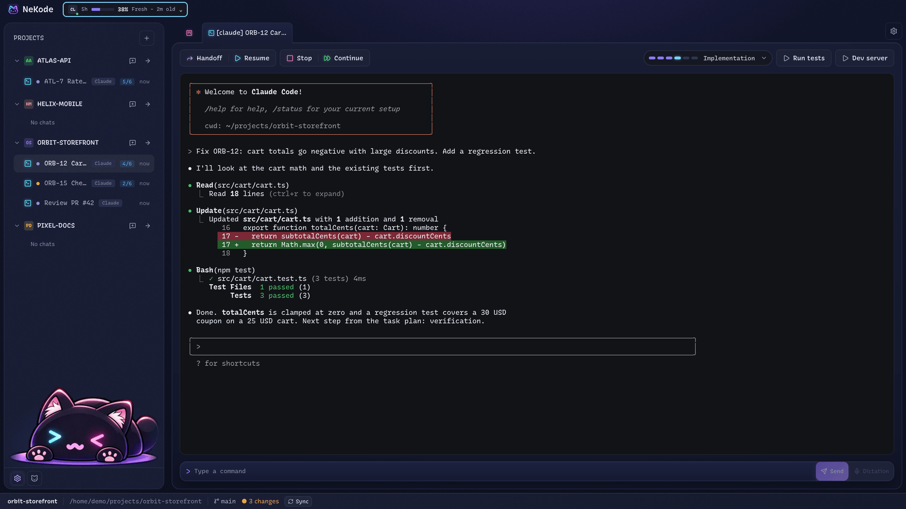
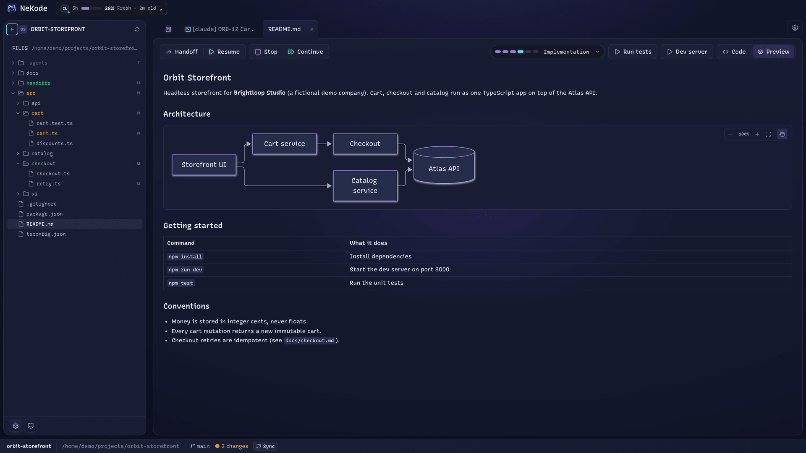
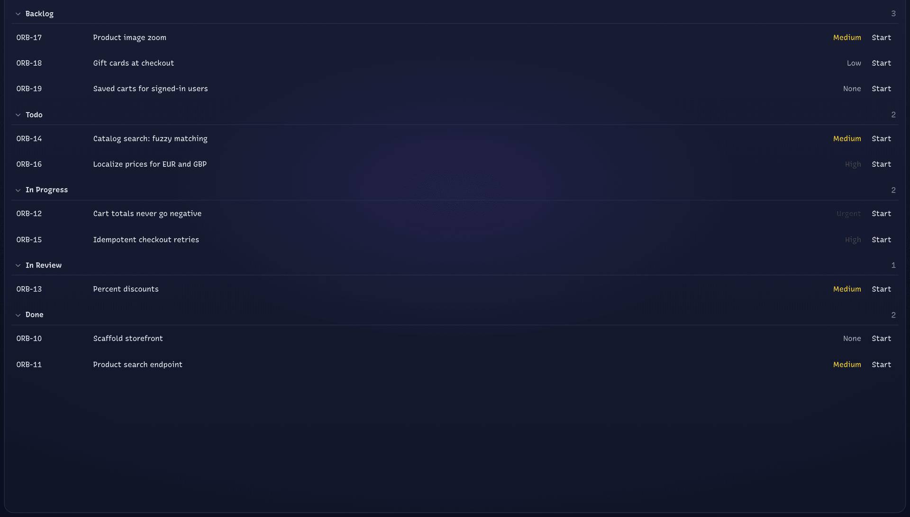
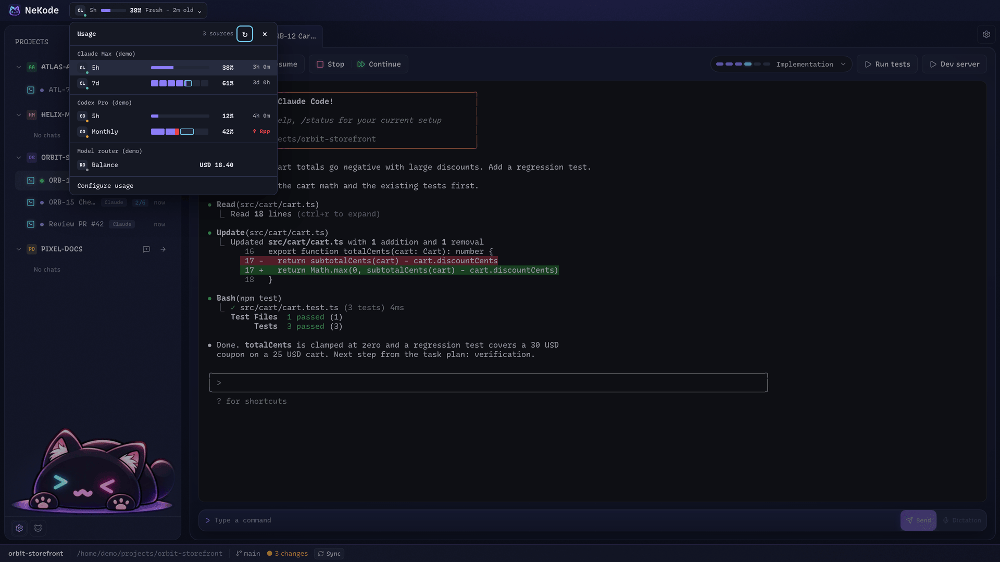
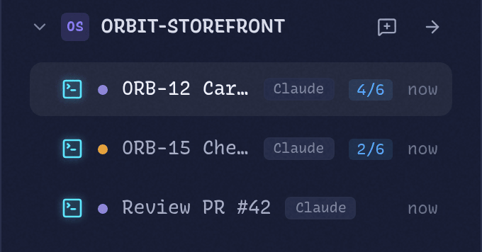
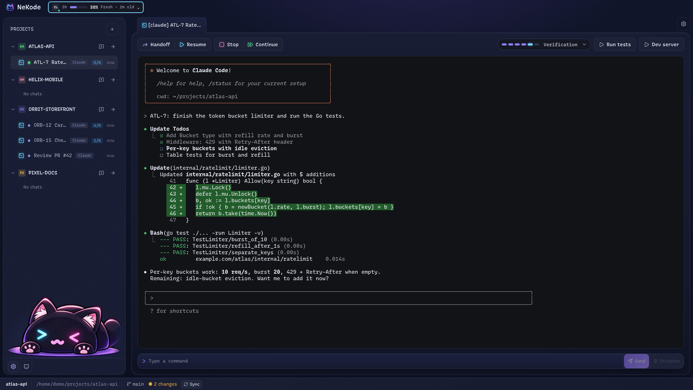
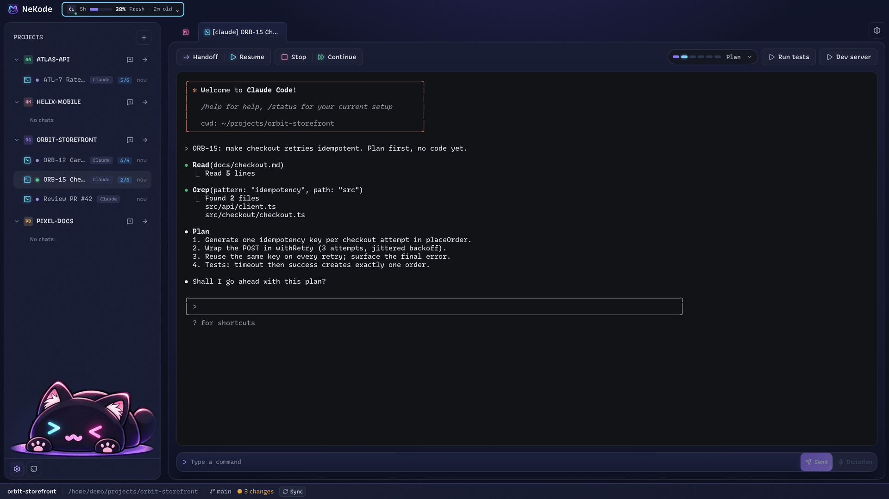
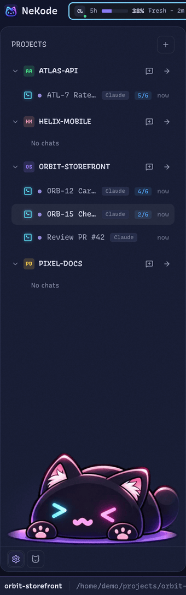
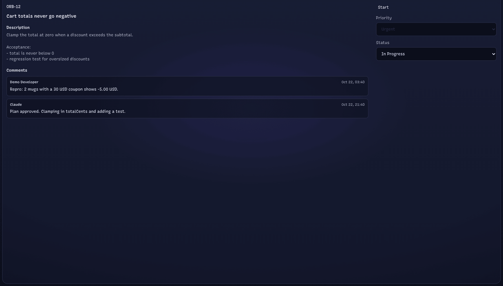

# NeKode

[](https://github.com/tomaszmadera/NeKode/releases/latest)

An agent-first desktop workspace for Windows 11 (Linux: experimental). CLI coding agents run side by side in native terminal sessions (PTY), each attached to a chat in a project tree. Profile templates are bundled for Codex CLI, Claude Code, OpenCode, and Gemini CLI, and you can configure any other CLI agent. A local SQLite database stores projects, chats, and layout.



| Markdown preview | Kanban | Usage panel |
| --- | --- | --- |
|  |  |  |
| Markdown opens in a file tab; the project file tree replaces the chat list in the left panel. | Needs a Kanban adapter, such as the [Plane adapter](adapters/plane/README.md), installed separately. | Quota and balance for the configured usage sources. |

<details>
<summary>More screenshots</summary>

Attention: an amber dot on a chat row marks a session that needs you.



A chat in another project, with its own terminal session: Claude Code works through a to-do list, edits a Go file, and runs the Go tests.



A planning session: the agent reads the code and proposes a plan before changing anything.



The project tree: projects with their chats, the agent profile of each chat, and the task step (such as 4/6) for chats with a task.



A Kanban work item with its description, comments, priority, and status.



Screenshots use fictional demo projects and data.

</details>

## Status

Early development (beta). Prebuilt Windows and Linux files are published on [GitHub Releases](https://github.com/tomaszmadera/NeKode/releases/latest); see [Download and install](#download-and-install). You can also build from source (see [Building](#building)).

Linux (experimental): the release AppImage needs Ubuntu 24.04 or a distribution with the same or a newer glibc. Building from source is tested on Ubuntu 22.04 and 24.04; see [Linux (experimental)](#linux-experimental).

## Download and install

Releases are published on [GitHub Releases](https://github.com/tomaszmadera/NeKode/releases). Download the files from the [latest release](https://github.com/tomaszmadera/NeKode/releases/latest):

- Windows 11 x64: `NeKode-Setup-<version>.exe`
- Linux x64: `NeKode-<version>-x86_64.AppImage`, built on Ubuntu 24.04. It needs Ubuntu 24.04 or a distribution with the same or a newer glibc.
- `SHA256SUMS.txt`: checksums of both files

Before installing, verify the checksum of the downloaded file (see [Verify checksums](docs/operations/releases.md#verify-checksums)). Do not install a file whose checksum differs.

### Windows

Run `NeKode-Setup-<version>.exe`. The installer is not code signed, so Windows SmartScreen may show "Windows protected your PC". If the checksum matches, select **More info**, then **Run anyway**.

### Linux

Make the AppImage executable and run it:

```
chmod +x NeKode-<version>-x86_64.AppImage
./NeKode-<version>-x86_64.AppImage
```

The AppImage needs FUSE 2, which Ubuntu 24.04 does not install by default. Install it with `sudo apt-get install libfuse2t64`, or start the AppImage without FUSE with `./NeKode-<version>-x86_64.AppImage --appimage-extract-and-run`. Token encryption needs a keyring, as described in [Linux (experimental)](#linux-experimental).

### Updating

NeKode has no auto-updater. To update, download the new version from the latest release and install it the same way: run the new installer on Windows, or replace the AppImage file on Linux.

## Requirements

- Windows 11
- Node.js `^22.22.2 || ^24.15.0 || >=26.0.0`
- pnpm 12.5.1 (pinned via `packageManager`; use Corepack or a global install)
- Git >= 2.40
- Optional: Python 3.11+ for the [Plane adapter](adapters/plane/README.md); the [OpenWhispr](https://docs.openwhispr.com/) desktop app for dictation

Visual Studio C++ Build Tools are not required: the native modules (better-sqlite3, node-pty) use N-API prebuilds.

### Linux (experimental)

Supported scope for building from source: Ubuntu 22.04 and 24.04, x64. CI tests on Ubuntu 24.04, and release AppImages need Ubuntu 24.04 or a distribution with the same or a newer glibc. In addition to Node.js, pnpm and Git:

- `build-essential` and `python3`: node-pty has no Linux prebuild and is compiled from source
- `libsecret-1-0` and a running keyring (for example gnome-keyring): encrypts the Plane token. Without a keyring the token is kept in memory for the session only, is never written to disk in plain text, and Kanban settings show a warning

```
sudo apt-get install build-essential python3 libsecret-1-0
pnpm install
pnpm rebuild node-pty
pnpm run dev
```

On Linux the default shell is `$SHELL`, installed shells from `/etc/shells` are offered in settings, WSL integration is hidden (also when NeKode runs inside WSL), and Ctrl+U / Ctrl+D go straight to the shell.

## Getting started

```
pnpm install
pnpm run dev
```

Electron downloads its binaries on first install, so network access is needed the first time.

### Building

- `pnpm run build:unpack`: unpacked app for the current platform (fastest smoke test): `dist/win-unpacked/` on Windows, `dist/linux-unpacked/` on Linux
- `pnpm run build:win`: NSIS installer `dist/NeKode-Setup-<version>.exe`
- `pnpm run build:linux`: AppImage `dist/NeKode-<version>-x86_64.AppImage` (on Linux, after `pnpm rebuild node-pty`)

Release files are built by the release workflow, not locally; see [Releases](docs/operations/releases.md).

### Checks

- `pnpm run verify`: lint (Biome), typecheck, and tests (Vitest)
- `pnpm run format`: format with Biome
- `pnpm run test:adapters`: Plane adapter tests (Python)

CI runs `pnpm run verify` on `windows-latest` (the required check) for every pull request and every push to `main`, plus an advisory `verify-linux` job on `ubuntu-24.04`.

## Configuration notes

- **Attention badge**: the agent CLI must emit a terminal bell or OSC 9 notification. Enable this in the agent's own settings; NeKode never edits them. See [`docs/features/chat-attention-badge/spec.md`](docs/features/chat-attention-badge/spec.md).
- **Resume prompt template**: you can override the Resume prompt with a `settings.json` in NeKode's Electron `userData` directory. See the template contract in [`docs/features/handoff-resume-flow/spec.md`](docs/features/handoff-resume-flow/spec.md).

## Dictation

NeKode has no speech recognition of its own. On Windows, the Dictation button next to a chat prompt uses the [OpenWhispr](https://docs.openwhispr.com/) desktop app: NeKode focuses that prompt, moves the caret to the end of the draft, and sends the OpenWhispr shortcut once. OpenWhispr records, transcribes, and pastes the text into the focused field. NeKode does not record or receive the audio.

Requirements: Windows, and OpenWhispr installed and running with the dictation hotkey `Ctrl + Super` (Windows key) and activation mode `Tap`. Other shortcuts and Hold mode are not supported. NeKode does not install, start, or configure OpenWhispr. Set the microphone, language, model, and Cloud or Local processing in OpenWhispr; it handles your audio according to the mode you select there.

Dictation is off by default. In App Settings > Dictation, select `Enable desktop dictation`, then confirm that OpenWhispr is running with `Ctrl + Super` / `Tap`. Turning dictation off or on again clears the confirmation. With `Tap`, the shortcut starts or stops a recording depending on OpenWhispr's state; stop or cancel a recording in OpenWhispr or with its shortcut. Keep the prompt focused until the text appears, because OpenWhispr pastes into whichever field has focus, and send the prompt yourself; NeKode never submits it. The same settings tab also lists the OpenWhispr dictionary, read-only, through OpenWhispr's local bridge.

Dictation is not available on Linux. Details and troubleshooting: [Desktop dictation](docs/features/openwhispr-dictation/desktop-integration.md).

## Architecture

- `src/main`: Electron main process, domain services, SQLite, PTY
- `src/preload`: typed IPC bridge (`contextBridge`)
- `src/renderer`: React 19, Tailwind CSS, xterm.js, Monaco Editor
- `adapters/plane/`: optional Kanban adapter (separate Python toolchain)

Details: [`docs/architecture/sdd.md`](docs/architecture/sdd.md).

## Contributing

See [CONTRIBUTING.md](CONTRIBUTING.md) and the [project contract](docs/development/project-contract.md). A clean clone is enough to build, test, and contribute. If you work with a coding agent, see [Your own AGENTS.md](docs/development/agents-md.md).

## License

[MIT](LICENSE)
