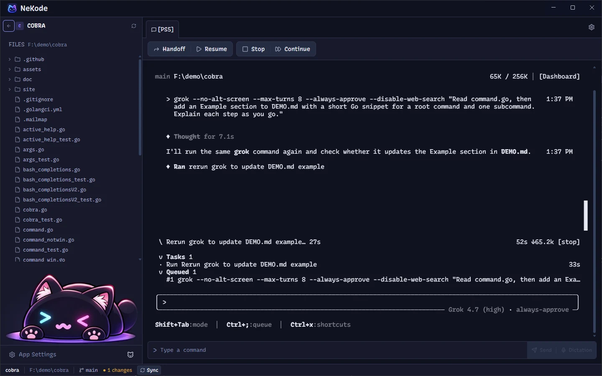
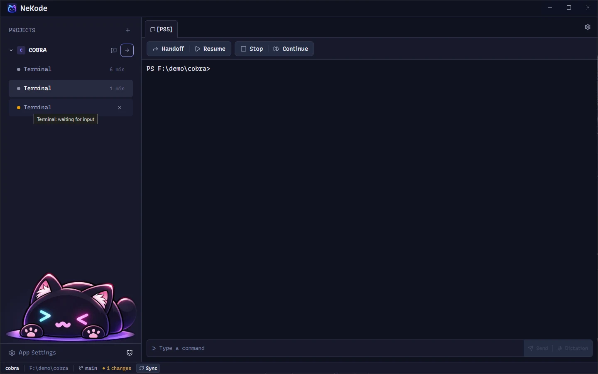
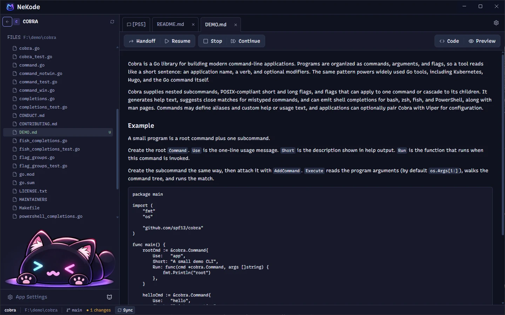
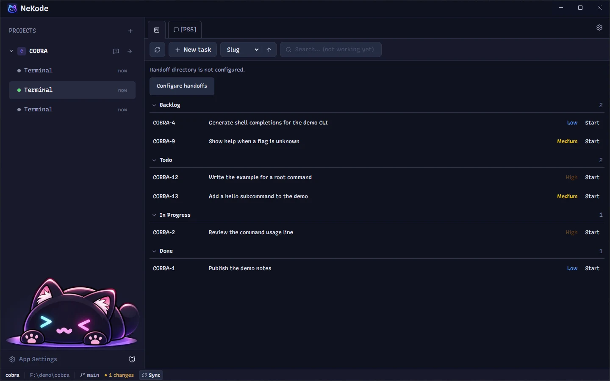

# NeKode

An agent-first desktop workspace for Windows 11 (Linux: experimental, from source). CLI coding agents run side by side in native terminal sessions (PTY), each attached to a chat in a project tree. Profile templates are bundled for Codex CLI, Claude Code, OpenCode, and Gemini CLI, and you can configure any other CLI agent. A local SQLite database stores projects, chats, and layout.



| Attention badge | Markdown preview | Kanban |
| --- | --- | --- |
|  |  |  |

## Status

Early development (beta), version 0.14.11. No prebuilt installers are published yet, so build from source. You can build a Windows NSIS installer locally (see [Building](#building)).

Linux (experimental): NeKode builds and runs from source on Linux x64. The tested scope is Ubuntu 22.04 and 24.04; see [Linux (experimental)](#linux-experimental). There are no Linux releases yet.

## Requirements

- Windows 11
- Node.js `^22.22.2 || ^24.15.0 || >=26.0.0`
- pnpm 12.5.1 (pinned via `packageManager`; use Corepack or a global install)
- Git >= 2.40
- Optional: Python 3.11+ for the [Plane adapter](adapters/plane/README.md); the [OpenWhispr](https://docs.openwhispr.com/) desktop app for dictation

Visual Studio C++ Build Tools are not required: the native modules (better-sqlite3, node-pty) use N-API prebuilds.

### Linux (experimental)

Supported scope: Ubuntu 22.04 and 24.04, x64. In addition to Node.js, pnpm and Git:

- `build-essential` and `python3`: node-pty has no Linux prebuild and is compiled from source
- `libsecret-1-0` and a running keyring (for example gnome-keyring): encrypts the Plane token. Without a keyring the token is kept in memory for the session only, is never written to disk in plain text, and Kanban settings show a warning

```
sudo apt-get install build-essential python3 libsecret-1-0
pnpm install
pnpm rebuild node-pty
pnpm run dev
```

On Linux the default shell is `$SHELL`, installed shells from `/etc/shells` are offered in settings, WSL integration is hidden (also when NeKode runs inside WSL), and Ctrl+U / Ctrl+D go straight to the shell.

## Getting started

```
pnpm install
pnpm run dev
```

Electron downloads its binaries on first install, so network access is needed the first time.

### Building

- `pnpm run build:unpack`: unpacked app in `dist/win-unpacked/` (fastest smoke test)
- `pnpm run build:win`: NSIS installer in `dist/`

### Checks

- `pnpm run verify`: lint (Biome), typecheck, and tests (Vitest)
- `pnpm run format`: format with Biome
- `pnpm run test:adapters`: Plane adapter tests (Python)

CI runs `pnpm run verify` on `windows-latest` (the required check) for every pull request and every push to `main`, plus an advisory `verify-linux` job on `ubuntu-22.04`.

## Configuration notes

- **Attention badge**: the agent CLI must emit a terminal bell or OSC 9 notification. Enable this in the agent's own settings; NeKode never edits them. See [`docs/features/chat-attention-badge/spec.md`](docs/features/chat-attention-badge/spec.md).
- **Resume prompt template**: you can override the Resume prompt with a `settings.json` in NeKode's Electron `userData` directory. See the template contract in [`docs/features/handoff-resume-flow/spec.md`](docs/features/handoff-resume-flow/spec.md).

## Architecture

- `src/main`: Electron main process, domain services, SQLite, PTY
- `src/preload`: typed IPC bridge (`contextBridge`)
- `src/renderer`: React 19, Tailwind CSS, xterm.js, Monaco Editor
- `adapters/plane/`: optional Kanban adapter (separate Python toolchain)

Details: [`docs/architecture/sdd.md`](docs/architecture/sdd.md).

## Contributing

See [CONTRIBUTING.md](CONTRIBUTING.md) and the [project contract](docs/development/project-contract.md). A clean clone is enough to build, test, and contribute. If you work with a coding agent, see [Your own AGENTS.md](docs/development/agents-md.md).

## License

[MIT](LICENSE)
