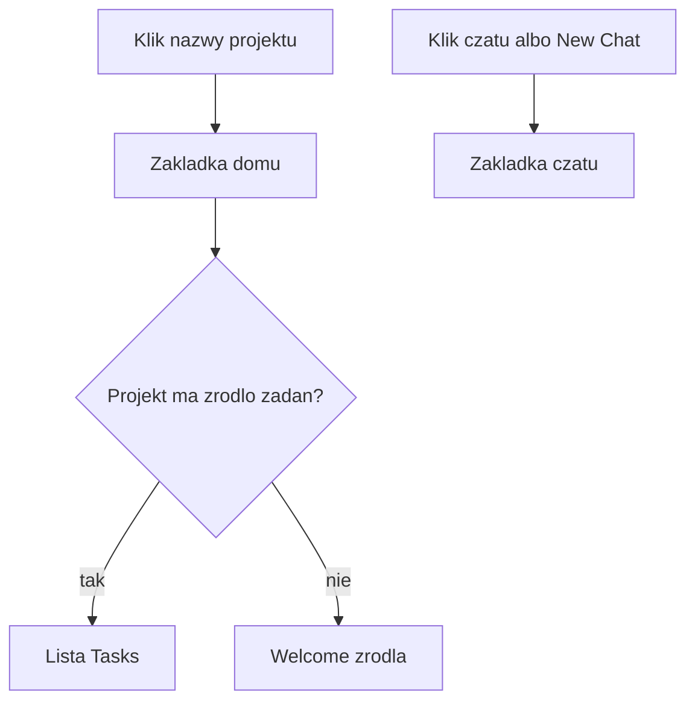
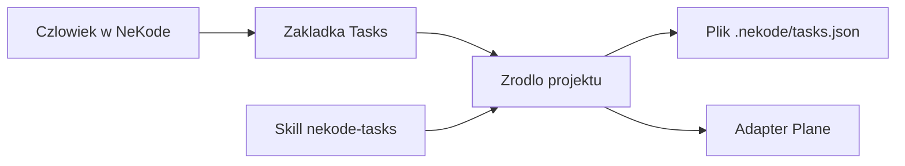

# Otwarcie projektu: zadania, welcome i lokalna lista

Stan analizy: 2026-10-24. Karta: NEKODE-127. To jest rekomendacja, nie specyfikacja i nie zmiana kodu. Pięć decyzji z końca dokumentu przyjęto w rozmowie 2026-10-24. Kontrakt docelowy jest w [spec.md](spec.md) (NEKODE-129). Plan zatwierdzono 2026-10-24. Kontrakt adaptera kanbanu i `docs/UX-UI.md` opisują dostarczone zachowanie, dopóki etapy tej specyfikacji nie wejdą.

## Rekomendacja

Nazwa projektu w lewym panelu zawsze otwiera jedną zakładkę domu. Na pasku widać skróconą nazwę projektu, tak jak dziś przy podpiętym adapterze. Zakładka jest obecna także wtedy, gdy adaptera nie ma.

Gdy projekt ma źródło zadań, ta zakładka pokazuje listę. To jest widok po kliknięciu nazwy. Welcome czatu zostaje na drugiej zakładce i nie jest już domyślną stroną projektu.

Gdy źródła nie ma, ta sama zakładka pokazuje krótkie welcome po angielsku: lokalna lista w pliku albo podłączenie trackera. Konfiguracja Plane zostaje w istniejących ustawieniach projektu. Nie dodaję osobnego menu obok paska.

Powierzchnia nazywa się **Tasks**. Backlog i Todo zostają nazwami stanów. Słowo Kanban zostaje w kodzie i w dotychczasowym kontrakcie do czasu osobnej zmiany napisów.

Dane trzyma plik `.nekode/tasks.json`, włączany jednym przyciskiem. Skill w Harnesie jest instrukcją dla wybranych agentów i tego pliku nie zastępuje. Plane zostaje opcjonalnym adapterem dla osób, które już go mają.

## Jak jest dzisiaj

Są trzy różne miejsca z nazwą projektu i trzy różne skutki kliknięcia.

W lewym panelu chevron tylko zwija listę czatów. Ikona i nazwa otwierają projekt, ale klik nazwy już wybranego projektu nic nie robi, żeby nie zdejmować aktywnego czatu. Tak jest zapisane przy przycisku nazwy w `src/renderer/src/components/layout/LeftNavigation.tsx:475` i w warunku `if (!isSelected)` w linii 521.

Wybór innego projektu czyści zaznaczony czat i nie przełącza zakładki na listę zadań (`src/renderer/src/App.tsx:1250`). Nowa sesja zakładek startuje od zakładki czatu (`src/renderer/src/components/tabs/tabs-session.ts:29`). Sesja zakładek żyje tylko do zamknięcia aplikacji (`tabs-session.ts:5`).

Środek przy braku wybranego czatu pokazuje welcome. Napis to "Start an agent chat in {projekt}", a przycisk to "New Chat" (`src/renderer/src/components/workspace/IllustratedSurface.tsx:27` i `WelcomeSurface.tsx:21`). Projekt bez żadnego czatu, już po wczytaniu listy, pokazuje ten sam obrazek jako stan "Start new chat" (`ChatWorkspace.tsx:234` i `541`). W obu przypadkach środek zachęca do czatu.

Zakładka listy istnieje tylko przy zapisanym adapterze. Widoczny napis to skrócona nazwa projektu, a podpowiedź to `Kanban: {nazwa}` (`src/renderer/src/components/tabs/TabStrip.tsx:144` i test `KanbanTabs.test.tsx:141`). Bez adaptera w tym samym miejscu jest zwykły napis, nie przycisk (`TabStrip.tsx:166`, test `KanbanTabs.test.tsx:147`).

Powiązanie to niepusty klucz `project.kanbanAdapter:<id>` (`App.tsx:600`). Po odpięciu aktywna zakładka listy wraca do czatu (`App.tsx:2548`).

Lewy kafelek Kanban opisany w Behaviour 14 specyfikacji adaptera i w `docs/UX-UI.md:842` nie jest już rysowany. Test nazywa go wycofanym (`KanbanTabs.test.tsx:103`). `LeftNavigation.tsx:62` nadal przyjmuje `onOpenProjectKanban`, ale komponent tej funkcji nie wywołuje. Jedyna droga do listy to zakładka na pasku. Handler w `App.tsx:1281` jest gotowy i ma właściwe zachowanie: przy tym samym projekcie zostawia zaznaczony czat, żeby powrót na zakładkę czatu pokazał ten sam czat.

Na starcie aplikacja przywraca zapisany czat (`App.tsx:1016`). Zakładek środka nie przywraca, więc po uruchomieniu widać czat albo welcome, nie listę.

Samą listę da się skonfigurować dopiero po wejściu w ustawienia. Plansza ma stan "No Kanban adapter is configured" i przycisk Configure (`KanbanBoard.tsx:1847`), ale bez powiązania zakładka w ogóle nie powstaje, więc tego stanu nie widać z paska.

Ustawienia projektu mają osobną zakładkę o etykiecie `Kanban` (`ActionSettings.tsx:45`). Adaptery są plikami dokładanymi przez użytkownika. Specyfikacja wyklucza dostarczanie adaptera razem z aplikacją (`docs/features/kanban-adapter-interface/spec.md:46`).

## Mapa kliknięć

```mermaid
flowchart TD
  click[Klik w lewym panelu]
  click --> chevron[Chevron]
  click --> name[Nazwa projektu]
  click --> chatRow[Wiersz czatu]
  chevron --> fold[Zwija albo rozwija liste]
  name --> selected{Ten projekt jest juz wybrany?}
  selected -->|tak| idle[Nic sie nie zmienia]
  selected -->|nie| chatTab[Zakladka czatu]
  chatTab --> welcome[Welcome z New Chat]
  chatRow --> openChat[Ten czat na zakładce czatu]
```

| Miejsce | Skutek dziś | Skutek w rekomendacji |
|---|---|---|
| Chevron | Tylko zwija listę | Bez zmiany |
| Nazwa innego projektu | Wybór projektu, czat wyczyszczony, welcome | Wybór projektu i zakładka domu |
| Nazwa już wybranego projektu | Nic | Zakładka domu, czat zostaje zaznaczony |
| Napis nazwy na pasku bez adaptera | Nie da się kliknąć | Ta sama zakładka domu, welcome źródła |
| Nazwa na pasku przy adapterze | Otwiera listę | Bez zmiany roli: to jest zakładka domu |
| Wiersz czatu i New Chat | Zakładka czatu | Bez zmiany |

## Nazwy

| Słowo | Rola |
|---|---|
| Tasks | Powierzchnia, podpowiedź zakładki, zakładka ustawień i nagłówek pustego stanu |
| Task | Jedna pozycja. Przycisk `New task` już tak mówi |
| Backlog | Wyłącznie stan albo grupa stanu |
| Todo | Wyłącznie stan albo grupa stanu |
| Kanban | Nazwa historyczna w kodzie, IPC i obecnym kontrakcie. Znika z nowych napisów interfejsu |
| Work item | Typ adaptera. Użytkownik go nie widzi |

Tasks wygrywa, bo dzisiejszy widok jest listą pogrupowaną według stanu, a nie tablicą kolumn z przeciąganiem. Kolumny z `docs/UX-UI.md` §27 są późniejszą pracą. Kanban obiecuje tę tablicę już teraz. Backlog i Todo są już nazwami stanów w protokole (`backlog`, `todo` / `unstarted`), więc nazwanie nimi całej powierzchni zlałoby listę z jedną kolumną.

Zakładka nadal pokazuje nazwę projektu, skróconą do 10 grafemów (`TabStrip.tsx:50`). Słowo Tasks jest w podpowiedzi: `Tasks: {pełna nazwa}`. Dzięki temu pasek nadal mówi, który projekt jest otwarty, a ustawienia mówią, czym ta powierzchnia jest.

Identyfikatory `kanban:` i `KANBAN_TAB` zostają. Zmiana napisów nie jest zmianą nazwy modułu.

## Docelowy układ



Pasek, od lewej: zakładka domu, zakładka czatu, potem otwarte pliki. Domu nie da się zamknąć. Czat zostaje zawsze.

Klik nazwy, także powtórzony, aktywuje dom. Przy tym samym projekcie zaznaczenie czatu zostaje, tak jak już robi niewykorzystany `handleOpenProjectKanban`. Przy zmianie projektu zostaje dzisiejsze czyszczenie czatu.

Uruchomienie aplikacji z zapisanym czatem nadal otwiera ten czat. To jest powrót do przerwanej pracy, nie wybór projektu od nowa. Uruchomienie z projektem i bez zapisanego czatu otwiera dom: listę, gdy źródło jest, albo welcome źródła, gdy go nie ma. Samo welcome "Add project" zostaje dla pustego okna.

Welcome czatu nie dostaje linku do adapterów. Ma jedno zadanie: zacząć czat. Osoba, która chce zadań, jest już na zakładce domu, bo tam prowadzi nazwa projektu.

## Welcome bez źródła

Angielskie napisy, bo cały interfejs jest po angielsku:

- Tytuł: `No task list yet`
- Tekst: `Keep tasks in a file in this project, or connect a tracker.`
- Przycisk główny: `Use a local task list`
- Przycisk drugi: `Connect a tracker`

`Connect a tracker` otwiera istniejące ustawienia projektu na zakładce źródła. Dziś ta zakładka nazywa się Kanban. Po zmianie napisów nazywa się Tasks. Nie powstaje drugie menu ani trzecia stała zakładka "Configuration". Konfiguracja zostaje dialogiem, do którego welcome ma jeden link.

Po `Use a local task list` ta sama zakładka pokazuje pustą listę z `New task`. Nie ma drugiego przejścia.

Osobne menu konfiguracji, o które pytałeś, byłoby trzecim miejscem obok zakładki i ustawień. Welcome z dwoma przyciskami załatwia obie drogi bez nowego menu.

## Plik i skill



To są dwie warstwy.

Źródło odpowiada na pytanie, gdzie leżą zadania. Wbudowane źródło `local-file` czyta i zapisuje `.nekode/tasks.json` w procesie głównym, bez uruchamiania adaptera i bez tokenu. Zewnętrzny adapter, dziś Plane, zostaje procesem ze specyfikacji. Interfejs dalej dostaje te same stany i te same pozycje, więc obecna lista, `New task`, status i priorytet mogą zostać.

Skill odpowiada na pytanie, jak agent ma z tego korzystać. Jest instrukcją. Nie jest bazą. Agent, który zapisze zadania w treści skilla, rozjedzie je z listą widoczną w oknie. Dlatego włączenie listy i instalacja skilla są dwoma osobnymi potwierdzeniami.

Plik nie powstaje przy dodaniu projektu. Decyzja z 2026-10-23 dla postępu zadań mówi, że nic nie włącza się samo (`docs/features/task-progress-adapters/spec.md:14`). Ten sam gest pasuje tutaj: jeden przycisk, widoczny plik, brak niespodzianki w gicie. `.nekode/task-progress.json` zostaje snapshotem postępu sesji. `.nekode/tasks.json` jest listą pracy. To nie jest ten sam dokument.

Szkic pliku, do doprecyzowania w przyszłej specyfikacji: `schemaVersion` 1, stany z grupami `backlog`, `unstarted`, `started`, `completed`, `cancelled`, pozycje o polach, które lista już rysuje (`ref`, tytuł, opis, stan, priorytet). Puste stany domyślne: Backlog, Todo, In Progress, Done, Cancelled. Klucz powiązania zostaje `project.kanbanAdapter:<id>` z wartością `local-file`, żeby reguła "skąd brać dane" była jedna.

Skill nazywa się `nekode-tasks`. Treść mówi: używaj źródła tego projektu. Przy pliku lokalnym edytuj tylko `.nekode/tasks.json`. Przy Plane używaj zapisanego polecenia kanbanu projektu i nie kopiuj kart do skilla ani do drugiego pliku.

"Pod określonym agentem" nie ma dziś odpowiednika w danych. Profile agentów to komendy uruchomienia, a skille Harnesu leżą raz, w `.agents/skills/` (`docs/development/agent-skills.md:3`). Codex czyta ten katalog. Claude Code i Grok w tym repozytorium dostają cienkie wskazówki w `.claude/skills/` i `.grok/skills/` (`agent-skills.md:47`).

Rekomendowany gest w ustawieniach Tasks: `Teach agents`, z listą profili włączonych w tym projekcie. Zaznaczenie zapisuje jedną treść skilla i tylko te wskazówki, które wybrany agent na pewno czyta. Dla projektu innego niż NeKode nie wolno zakładać, że ma generator adapterów skilli. Pierwsza wersja zapisuje `.agents/skills/nekode-tasks/SKILL.md`. Dodatkowe ścieżki Claude i Groka dochodzą dopiero po sprawdzeniu, gdzie dany agent szuka skilli w obcym projekcie. Przed zapisem NeKode pokazuje listę plików. Samo włączenie pliku zadań nic w Harnesie nie zmienia.

Osoby z Plane nie dostają drugiego pliku. Ich źródłem zostaje Plane. Ten sam skill opisuje oba źródła, więc nie ma dwóch skilli do utrzymania.

## Odrzucone warianty

Welcome czatu z propozycją skilla miesza start agenta z konfiguracją listy. Nazwa projektu dalej lądowałaby na "New Chat", czyli na tym widoku, którego chcesz uniknąć, gdy lista już jest.

Sam link "Configure" bez lokalnego pliku zostawia Plane jako jedyną drogę. To jest dzisiejsza bariera: specyfikacja wymaga katalogu adapterów, manifestu i pól, zanim pojawi się pierwsza karta.

Skill jako jedyne miejsce danych jest wygodny dla agenta i słaby dla okna. NeKode musiałby czytać markdown skilla, a agent mógłby go przepisać. Plik zadań ma jeden schemat i dwóch klientów: okno i skill.

Włączenie pliku przy każdym nowym projekcie daje pusty `.nekode/` osobom, które chcą tylko czat.

Nowa stała zakładka "Configuration" dubluje ustawienia projektu. Welcome z przyciskiem `Connect a tracker` wystarcza.

Osobna baza skilli per profil agenta jest drugim produktem. Do tej karty potrzebny jest jeden skill i wybór, którym agentom go pokazać.

## Co później, w osobnych zmianach

1. Zakładka domu jest zawsze. Klik nazwy ją otwiera. Bez źródła widać welcome z dwoma przyciskami. Przycisk trackera otwiera istniejące ustawienia. Napisy Tasks wchodzą razem z tą zmianą. Behaviour 14 i `docs/UX-UI.md` §18 oraz §26 trzeba wtedy poprawić: kafelek w lewym panelu jest wycofany, a zakładka domu nie zależy od powiązania.
2. Wbudowane źródło `local-file` i `.nekode/tasks.json`. To zmienia zdanie specyfikacji, że każdy adapter jest plikiem użytkownika i osobnym procesem. Zdanie o postępie zadań zostaje: NeKode nadal nie dostarcza adaptera postępu.
3. `Teach agents`: jawny zapis `nekode-tasks` do projektu, dla zaznaczonych profili, po potwierdzeniu listy plików.

Krok 1 daje właściwe kliknięcie i właściwy pusty stan. Kroki 2 i 3 dają pracę bez Plane oraz dostęp agenta. Można je przyjąć osobno.

## Przyjęte decyzje

Przyjęte w rozmowie 2026-10-24. Obowiązują jako kierunek specyfikacji. Nie zmieniają jeszcze kontraktów ani kodu.

1. Widoczna nazwa to Tasks. Kanban zostaje tylko w kodzie i starym kontrakcie.
2. Klik nazwy zawsze otwiera zakładkę domu. Powtórzony klik tego samego projektu nie czyści czatu.
3. Start z zapisanym czatem nadal otwiera czat.
4. Plik zadań powstaje dopiero po `Use a local task list`.
5. Skill jest osobnym zapisem do repozytorium projektu, po pokazaniu ścieżek.

## Czego ten dokument nie rozstrzyga

Nie uruchamiałem aplikacji. Opis wynika z kodu, testów i kontraktów wymienionych wyżej.

Nie wybieram pełnego schematu JSON, blokady zapisu przy dwóch równoczesnych edycjach ani tego, czy plik ma być domyślnie w `.gitignore`. To należy do specyfikacji kroku 2.

Nie wiem, których katalogów skilli szukają Claude i Grok w projekcie innym niż to repozytorium. Do pierwszej wersji wystarcza `.agents/skills/nekode-tasks/SKILL.md`. Resztę trzeba sprawdzić na wybranym agencie, zanim NeKode zapisze drugą ścieżkę.
