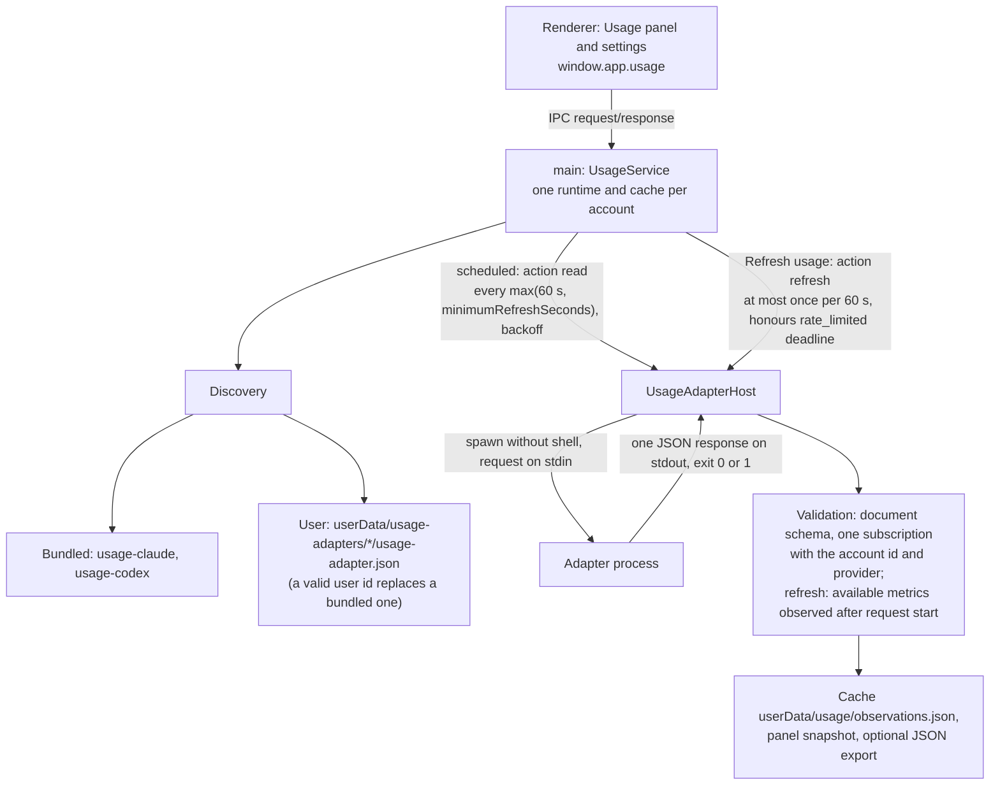
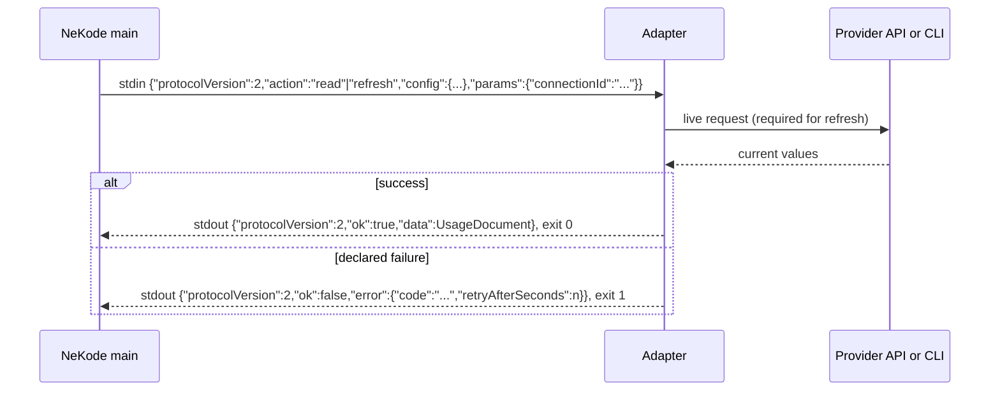

# Usage quota

Status: Delivered (Stages 1-3 implemented, reviewed and fully verified; live provider reads not run). Amendment "accounts settings flow" (task `usage-accounts-ux`, rules 21-28) approved by the user on 2026-10-22; implemented, in review.
Path: `docs/features/usage-quota/spec.md`.

NEKODE-116 amendment (approved by the user on 2026-10-24): rules 21-28, acceptance criteria 15 and 18, and their verification text below use Sources and Adapters. For settings terminology these changes supersede the earlier accounts settings wording, including rules 1-3 and the L7 message; the live refresh amendment still owns collection and discovery. No removed reader is restored.

Current adapter model: protocol version 2 with a required live `refresh`, adapters only (no built-in readers), and the bundled Claude Code OAuth adapter. The amendment "Amendment: live refresh and Claude OAuth adapter" overrides the earlier rules it names in L9; `Local adapter contract` below shows the current interface with diagrams.

ElevenLabs removal amendment (approved by the user on 2026-10-24, PDH-13): remove only the bundled `usage-elevenlabs` adapter, its registration, packaging and dependent tests/documentation. The current shipped adapters are Claude Code and Codex. The ElevenLabs integration and stored data in Personal Data Hub remain. Historical Stage 3 approval below does not restore this adapter.

OpenRouter removal amendment (approved by the user on 2026-10-24, PDH-13): remove only the bundled `usage-openrouter` adapter, its registration, packaging and dependent tests/documentation. OpenRouter balance remains only in Personal Data Hub and Rainmeter; its PDH integration and stored data remain. Historical Stage 3 approval below does not restore this adapter. Generic balance metrics remain supported for user adapters.

## Goal

Show subscription and account allowances in one global panel, with an optional pinned meter on the title bar. Collection must be independent of project, chat, and agent profile. Missing or old data must remain distinguishable from zero usage.

This is the approved contract for NEKODE-90. On 2026-10-20 the user approved all three implementation stages: local panel and JSON import/export, Claude/Codex collection, and ElevenLabs/OpenRouter adapters. Codex remains explicitly experimental; provider access and CLI configuration changes require their separately described opt-in. No commit, push, worktree creation, or publication is authorized. Amendment approved by the user on 2026-10-21 (Stage 2 review): the Claude source is a per-session snapshot directory shared with the optional Agent Harness format, and a global `Show usage quota` switch, off by default, controls the whole feature. Source research and its limits are in [analysis.md](analysis.md). Amendment approved by the user on 2026-10-21 (task `usage-bundled-adapters`): NeKode ships its usage adapters and the Claude snapshot writer with the app, `<userData>/usage-adapters` holds only user-added adapters, and the adapters directory setting is removed. Amendment approved by the user on 2026-10-22 (task `usage-accounts-ux`, user decisions recorded in `.agents/tasks/archive/usage-adapters-ux-analysis/analysis.md`): the settings show accounts instead of connections, through a service picker and a one-account editor; services declare their provider id; a JSON file account binds to a subscription chosen from the file; the Claude writer has no default directory and NeKode proposes its own; NeKode, Agent Harness, and any hosted aggregation service stay independent and connect only through adapters.

## Related requirements

- [Local setup and adapter protocol](usage.md), [JSON schema](schema.json), and [example observations](example.json) document the Stage 1 file integration. [Claude Code usage adapter](claude-code.md) and the [Codex adapter](codex.md) document the Stage 2 integrations. [OpenRouter removal](openrouter.md) and [ElevenLabs removal](elevenlabs.md) record the removed Stage 3 adapters.
- NEKODE-90: subscription quotas, optional integration, reuse of existing collection, provider adapters.
- [Product requirements](../../product/requirements.md): English UI and terminal-first agent execution.
- [UX/UI](../../UX-UI.md) and [design system](../../references/NeKode-Design-System.md).
- User-provided visual reference: local `tmp/nekode-prototype/Main.dc.html`, usage panel and toolbar. The dimensions and behaviours needed for implementation are specified below; a public clone need not contain that local export.

## Scope

Global `Usage` settings, subscription records, optional local adapters, normalized quota observations, cached rendering, pin persistence, opt-in JSON export, and the panel. Initial integrations: normalized JSON input, Claude Code session snapshot directory (with an optional status-line snapshot writer), explicitly experimental Codex app-server adapter, and OpenRouter account balance (historical scope, superseded by the removal amendment above).

## Non-goals

Model calls, prompt injection, scraping a terminal or billing website, billing mutations, top-ups, consuming reset credits, quota enforcement, token-based estimates of subscription percentages, arbitrary hosted no-code synchronization, plugin marketplace, and historical analytics. No changes to Agent Harness collection or upload; reading a directory written by another tool is read-only reuse. NeKode ships no integration with a private or hosted aggregation service and no UI text names one or Agent Harness; such a service is reached through a user adapter (rule 18) maintained outside this repository, and NeKode sends no usage to it. Direct Command Code, AGY, and Grok adapters await separate source confirmation; imported observations can represent these subscriptions.

## Behaviour

### Configuration and identity

1. `App Settings > Usage` has a global `Show usage quota` switch, off at fresh install; a missing setting means off. While off, the title-bar button is hidden and the usage service schedules nothing: no file reads, processes, network requests, or export writes. Connections, pin, and cache are retained, and turning the switch on resumes them. `App Settings > Usage` stays reachable while off. It manages accounts globally; the UI calls them accounts and the stored contract keeps the name connection (`UsageConnection`). A connection has an immutable local id, user-facing account label, provider id, selected adapter, enabled flag, and adapter configuration. The user never types the id or the provider id (rule 23). Source type and supported capabilities appear under `Advanced` (rule 26). No adapter runs until the user saves an enabled account. The toolbar entry opens an empty state with `Configure usage` when none are enabled.
2. One connection represents one subscription/account scope, regardless of how many projects, chats, or profiles use it. The user assigns the account scope; do not infer identity from an executable name, email in a prompt, or model. Each quota has a stable id within that connection, including any provider bucket id. Configure one authoritative source per connection; one provider account is configured once, not through two services. Switching accounts or adapters invalidates its old data and pin target. Two different accounts remain separate, with distinct labels. A JSON file account binds to one subscription chosen from the file (rule 25); two accounts cannot bind the same file subscription.
3. Save/test configuration through main, one account at a time (rule 23). Native path pickers select JSON input and output files and the Claude snapshot directory. There is no adapters directory setting (rule 17). Show pending, success, and typed error states. A failed save preserves the form and previous working configuration. Disable/remove stops scheduling and cancels obsolete requests; late results cannot recreate the connection.

### Panel and toolbar

4. While `Show usage quota` is on, add a 32px-high `Usage quota` button to the title bar, after the brand, leaving native caption controls and a usable drag region. Interactive descendants use `no-drag`. At narrow widths the button may collapse to an accessible icon. The existing title-bar height stays unchanged.
5. Clicking toggles a panel anchored to the button, approximately 6px below the title bar. Width 400px, maximum viewport width minus 24px, maximum height to the bottom margin, vertical scrolling. Clamp the anchor inside the viewport instead of hard-coding the prototype's `left: 250px`. Header has `Usage`, a source/freshness summary, `Refresh usage`, and `Close usage panel`. Outside click and Escape close it; focus enters the panel, remains within it while open, and returns to the trigger. The panel has an accessible dialog name and no drag region.
6. Match the prototype's compact rows: about 30px high, 14px horizontal padding, 10px column gaps, a 20px avatar on every row carrying that row's freshness badge (rule 10), quota period, graphic, percentage, and reset/pace hint. Default desktop columns are `132px minmax(0, 1fr) 36px 60px`; narrow layouts reflow without losing values or keyboard controls. The avatar shows the metric's `providerId` when the metric declares one (an adapter that aggregates several providers in one account), otherwise the account's provider id. Group rows under the subscription label; every row keeps an accessible full label. Below an account's rows the panel shows only that account's current error, if any; it does not repeat the adapter id or per-row freshness, which each row already shows.
7. Use theme tokens with the reference dark palette as the visual target: panel `#151823`, border `#2f364e`, track `#232838`, fill `#8b7cf6`, current slice outline `#7dd3fc` drawn inside the slice so it never covers a gap, unused past slice `#ef4444` (behind pace is a loss to act on, not an amber notice; user decision 2026-10-22), pin background `#262b3f`. Panel radius 10px and shadow `0 20px 50px rgba(0,0,0,.55)`. Main labels use 12px monospace, percentage 12px bold, and secondary text 11px. Preserve contrast and focus indicators in every supported theme. Prefer existing tokens over adding equivalent hard-coded colours.
8. Known short windows show a bar, percentage, and reset countdown. A known fixed seven-day window shows seven equal elapsed-time slices anchored to that window, not the calendar week. A known monthly cycle splits its actual interval into four equal slices. Slices of one graphic have equal whole-pixel widths separated by exact 2px gaps; spare pixels stay after the last slice (user decision 2026-10-22). Use segmentation/pace only when cycle boundaries are known. Otherwise show a continuous percentage bar and known reset. A balance row shows currency and amount without a percentage bar. Do not fabricate 5h, 7d, monthly, or provider-specific rows.
9. Clicking a valid metric row pins it to the toolbar. Persist `{connectionId, metricId}` globally across restarts; highlight the selected row and expose `aria-pressed`. The toolbar repeats that metric's avatar, period, miniature graphic, value, and freshness. Preserve a pin through refresh failures, with its explicit unavailable/old state. If the target is removed or changes identity, clear it and show the neutral `Usage` button. A pin request the service cannot accept (account removed, disabled, or changed in the same save, or the metric absent or unavailable) fails with an error naming the reason, which the toolbar shows; the previous pin stays. Do not silently select a metric to pin. Initially no metric is pinned.
10. Every configured source has a textual last-observation age and status available without relying on colour or hover. Known ages: up to 5 minutes fresh, over 5 through 60 minutes aging, over 60 minutes stale, matching the prototype's green dot, amber dot, and coral ring/dimmed row. Errors and expired windows override a fresh badge; a recent file read cannot erase them. Tooltips add exact timestamp, account/scope, source, and reset details. The toolbar provides the same information in its accessible name or description.
11. Refresh retains existing rows and focus, shows `Refreshing usage...`, and deduplicates in-flight requests. Each connection succeeds or fails independently. With no observations show `No usage data yet`; with no source capability show `Unavailable`. Failure retains the last successful observation with its age and error, not a zero value.

### Collection and freshness

12. Main owns one scheduler and one cache per connection. While the application is visible, poll API/command sources at most once per 60 seconds, or less frequently if the adapter declares a larger minimum. Poll configured local JSON inputs at most once per 5 seconds. The pinned meter continues updating with the panel closed. Hidden/minimized windows pause polling; showing the app performs one due refresh. Shutdown clears timers and terminates child processes. Disabled/unconfigured sources, and every source while `Show usage quota` is off, produce no file reads or network/process activity.
13. Manual refresh may request an immediate read but obeys single-flight, adapter minimum interval, and provider backoff. After network/timeout failures retry at 60, 120, 240, then at most every 300 seconds. A rate-limit retry deadline overrides a shorter delay. Authentication, unsupported-version, and invalid-configuration failures suspend automatic retries until configuration changes or an explicit retry. One source cannot block another. Local JSON file sources (decision 2026-10-20): a missing input file and protocol, validation, or I/O failures are transient, not invalid configuration; automatic collection retries at the 5-second local cadence without growing backoff, and manual refresh skips failure backoff for that source while still obeying single-flight and the 5-second minimum interval. Invalid configuration for a file source means a path the settings validation rejects (not absolute, alias, or input/output overlap). Command and API sources keep the 60, 120, 240, 300-second schedule for protocol and validation failures.
14. Separate `observedAt` (when the source actually knew the value), `receivedAt` (when main accepted it), and `collectedAt` (when the adapter ran). Only `observedAt` determines data age. A poll of unchanged cached data preserves its observation time. If the source cannot establish observation age, set `observedAt: null`, display `Age unknown`, and do not claim fresh data. No guessing freshness from file mtime, adapter execution, or a changed reset countdown. Reject observation timestamps more than 60 seconds in the future. An older observation cannot overwrite a newer one for the same connection and metric; an age-unknown replacement cannot overwrite a dated observation for the same period without an explicit cache invalidation. An API response without an observation timestamp may use its completed GET time only when the endpoint represents a current snapshot, with this mapping documented by the adapter.
15. When the reset time passes without a new valid observation, that window becomes `Expired - refresh required`; retain its historical value as old data and exclude pace calculations. Do not advance the period or reset usage locally. Claude's documented status-line payload has no observation timestamp for quota, so Claude metrics use `observedAt: null` and report collection time separately. Repeated payloads cannot become fresh just because the status-line script ran. A missing/removed window is explicit unavailability, not zero. Independent writers use separate files; one collector owns each input.
16. (Superseded by the live refresh amendment, L6-L9.) The Claude source is a snapshot directory that holds one account's sessions. Each Claude Code session writes its own `<session_id>.json` by atomic rename: the raw status-line JSON written by another tool's status-line script, or the reduced document written by NeKode's setup (`session_id` and `rate_limits` only). A built-in reader (`claude-code-snapshots`, with the file cadence and retry semantics of rules 12-13) reads only `rate_limits` from at most the 256 most recently modified regular `*.json` files of at most 256 KiB each; modification time selects files and never sets freshness. It never writes to the directory. Per window, a later `resetsAt` wins; for the same `resetsAt` the higher `usedPercent` wins, because usage within one window does not decrease; a numeric `resetsAt` beats an unknown (null) one only while it is still in the future, and a value is kept across polls only for a window whose numeric `resetsAt` is still in the future (user decision 2026-10-21); a window absent or invalid in one file does not erase a valid value from another. Unparseable, oversized, or foreign files are skipped; a directory without any valid window yields `not_reported` unavailability. A missing directory whose parent exists is transient `io`. Several Claude accounts need separate directories; the reader cannot detect mixed accounts, so setup and documentation state this. Each Claude account is recorded once per computer: when another tool already records its usage, the user selects that tool's directory or adds that tool's adapter and does not install NeKode's writer. Setup refuses a second NeKode writer; it cannot recognise other recorders, so its preview prints the status-line command it would keep and states this rule.

### Bundled and user adapters

17. NeKode ships these usage adapters with the app: `usage-claude` and `usage-codex` (discovered adapters with a manifest; the earlier `usage-claude-code` snapshot writer is removed, L8). Their source of truth is `adapters/` in the repository. A packaged app copies them read-only into its resources (`<resources>/usage-adapters/<name>` for adapters, `<resources>/usage-collectors/claude-code` for the writer); an app update replaces them with the installed version. An unpackaged app reads them from `adapters/<name>` in the repository. Installing NeKode never copies adapters into user data, and no user step installs a shipped adapter. `adapters/usage-file` is a protocol example and is not shipped; the built-in `usage-file` reader covers JSON input.
18. Discovery lists the built-in readers, then the bundled adapters, then user adapters found one level under `<userData>/usage-adapters`. Only the named bundled directories are read, so other repository folders under `adapters/` never appear. A missing bundled directory is not reported as an adapter. A valid user adapter whose id equals a bundled adapter's id replaces that bundled adapter in the list; the bundled one is hidden. An invalid user manifest never hides a bundled adapter. Duplicate ids within the user directory, or a user adapter that reuses a built-in reader id (`usage-file`, `claude-code-snapshots`), stay disabled as duplicates. `Advanced` shows whether each adapter is built in, shipped, or user-added (rule 26).
19. A bundled adapter whose manifest command is `node` runs with the NeKode executable in Node mode (`ELECTRON_RUN_AS_NODE=1`), so it needs no separately installed Node.js. Settings show this as the executable. User adapters run their manifest command unchanged. The Claude snapshot writer is started by Claude Code, not by NeKode, so it keeps the setup script's `--node` executable (default `node`); its documentation names the bundled path to pass to setup.
20. A saved settings value from before rule 17 that contains `adaptersDirectory` loads without error and the value is ignored; the next save writes settings without it. The renderer cannot send `adaptersDirectory`. An account configuration holds only fields its adapter's current manifest declares. A stored field the manifest no longer declares is ignored for account identity and dropped by the next save; a field the renderer adds that the manifest does not declare is rejected. Field order never changes account identity.

### Sources settings flow

21. A source is one configured row: adapter, settings, and user-facing name (for example "PDH" or "Claude Max (work)"). An adapter is the program that reads quota limits. A source can report one account or aggregate several agents; it remains one stored `UsageConnection`. `App Settings > Usage` shows, in order: the `Show usage quota` switch with its explanation, `Sources`, `Write usage to a JSON file`, and collapsed `Adapters`. `Sources` starts with: "Each source reads quota limits through an adapter and shows them in the title bar. One source can report one account or, like a hub, several agents." Each saved source is one row with its name, adapter name, limit count (`1 limit`, `7 limits`), a textual status (`Disabled`, the current error message, `Last reading <age>`, `Last reading, age unknown`, or `No reading yet`), `Edit`, and `Remove`. Count the metrics in its retained snapshot, including unavailable or expired metrics; count neither agents nor configured sources. When no subscription has been received show `No limits yet`, not an invented zero. Preserve the existing observation-age calculation and error/disabled status precedence. `Remove` asks for inline confirmation, then saves immediately. With no sources the section shows the intro sentence and `Add source`. Settings call configured rows sources, and readers adapters; provider account names and adapter-supplied descriptions may still say account. Internal connection, subscription, and provider ids are not editable.
22. `Add source` opens `Choose an adapter`: one button per usable discovered adapter with its name, manifest `summary`, origin tag (`Built-in`, `Shipped`, or `Added by you`), and `Experimental` when declared. Origin follows actual discovery metadata; the current model has shipped and user-added adapters only (L6-L9), so no built-in option or tag is fabricated. Invalid adapters are not offered; `Adapters` lists them with their error. Choosing an adapter opens the source editor; `Back` returns without saving.
23. The source editor shows `Name` (required, example "Claude Max (work)"), `Adapter` (read-only adapter name), adapter description and configuration fields, `Enabled` (on for a new source), `Test`, `Save`, and `Cancel`. The adapter of a saved source cannot change; the user removes the source and adds another. The renderer generates the connection id (UUID) and never shows it. Main sets the provider id on save: the adapter's declared `providerId`, otherwise the adapter id; a provider id sent by the renderer is ignored. A source the save request leaves unchanged keeps its stored provider id, so a source saved before its adapter declared one changes only when the user edits it. A read must return the connection id; its provider id must equal the connection's provider id when the adapter declares one. `Save` stores only the edited source: the request contains the stored settings with that one source added or replaced, so unsaved edits elsewhere cannot exist. `Cancel` discards the editor. `Test` remains unavailable while `Show usage quota` is off (rule 12). This terminology change requires no settings, cache, pin, IPC, or adapter protocol migration.
24. (Superseded by the live refresh amendment, L6-L9.) The Claude Code editor proposes the directory `<userData>/claude-code-usage/<connection id>` for a new account; the user can choose another directory, such as one written by another tool. Saving or testing creates the proposed directory when it does not exist. `Copy setup command` copies the setup preview command (without `--apply`), filled with the shipped setup script path, the user's `~/.claude/settings.json`, and the chosen directory. The editor states: one directory per Claude account, and when another tool already records Claude usage on this computer, select its directory instead of installing the writer (rule 16). The writer and setup accept no default directory: `--dir` is required. Installed status-line commands already pass `--dir`, so they keep working.
25. (Superseded by the live refresh amendment, L6-L9.) The Custom JSON file editor picks the input file, then main reads it with the file adapter's bounds (only while `Show usage quota` is on, like `Test`, rule 12) and returns each subscription's id, provider id, and label, without metrics. One subscription is selected automatically; several show a choice; none, or an invalid document, show the error and block `Save`. The chosen id is stored as the optional `subscriptionId` configuration field, and an empty `Name` takes the subscription label. Reads select the subscription whose id equals `subscriptionId` (a connection saved before this rule uses its own id) and ignore the others. A file that no longer contains it fails as a transient file error (rule 13) naming the missing id; NeKode never rebinds to another subscription. Two accounts with the same input path and subscription id are rejected on save.
26. Collapsed `Adapters` lists every discovered adapter by origin (shipped, then user-added, retaining discovery order within each origin), with name, id, origin tag as in rule 22, directory path when present, source kind, capabilities, executable path/command and arguments, and any manifest error. It states that adapters are trusted executables that run with the user's permissions and offers `Open adapters folder`, which creates `<userData>/usage-adapters` when missing and opens it in the system file manager. Renaming the section does not change discovery or user overrides.
27. `Write usage to a JSON file` holds the export settings with its own `Save`, which stores only the export settings. Its explanation: "Other programs on this computer, such as dashboards or sync scripts, can read this file. It contains no secrets." It also keeps the separate-file and retained-file notes, and no sentence about hosted consumers. `Choose output file` has visible button styling using the existing settings border, padding, hover, and focus conventions. It remains a keyboard-operable native-file-picker action and does not save settings before the export save action.
28. NeKode-owned settings messages and source failures shown by main say source for a configured row and adapter for its reader, including save/remove notices, test prerequisites, missing adapters, validation, and secret-storage errors. Provider account terminology and adapter-supplied text retain their actual meaning. The L7 fixed legacy-source message becomes "This adapter is no longer available. Remove the source and add it again with a supported adapter." Its error code and retained cache/pin behaviour do not change. Removed built-in readers stay unavailable (L6-L9).

## Business rules

- Usage percentages describe provider-reported allowance, never context-window usage or a sum of session costs. Finite percentages are nonnegative; raw values above 100 remain visible if the provider supports overage. Clamp only graphic fill to `[0, 100]`. A nonpositive credit limit cannot produce a percentage.
- For known `[start, end)` intervals, elapsed proportion is `(now - start) / (end - start)` clamped to `[0, 1]`. Current slice and equal-use targets use that interval. Use absolute timestamps and actual interval lengths, not machine weekdays or a hard-coded month length. Re-render countdown and freshness locally without relabelling observations as new.
- Within a slice's lower/upper share, show no pace warning. Below the lower share, tint the unused past portion with the behind-pace red and show `up-arrow Npp` in that colour; above the upper share, stripe future-slice consumption and expose `Ahead of pace` accessibly. Differences are percentage points rounded to a whole point. Tooltips explain this is a planning comparison, not a provider restriction or a prediction that quota will certainly expire unused. Expired windows and unavailable data have no pace advice. Stale or age-unknown observations of an open window keep pace advice, because usage within a window never decreases (user decision 2026-10-22).
- Derive duration from an explicit provider contract or response. Codex `primary` and `secondary` do not intrinsically mean 5h/7d; preserve multiple `limitId` buckets. A reported reset plus an explicitly fixed duration can determine the start; a monthly reset alone cannot.
- OpenRouter balance is outside NeKode; its bundled adapter has been removed. Generic balance metrics from user adapters remain supported, with no invented period or percentage.

## Authorization

Only the trusted renderer can invoke typed usage channels. Main validates all input, configured ids, paths, versions, and payload bounds before mutation or adapter invocation. Do not weaken Electron isolation.

Adapters are trusted local executables, not a sandbox. Settings must show the executable and explain that enabling a plugin allows it to run with the user's permissions. Spawn only a manifest from a bundled adapter directory or from `<userData>/usage-adapters`, using an argument array with no shell. Secret values travel over stdin, never argv, diagnostics, exports, or response DTOs. Store configured API secrets encrypted with Electron `safeStorage`; if unavailable or decryption fails, show a configuration error and do not save plaintext or invoke the provider. Secret fields are write-only, with an explicit clear action.

(Superseded by the live refresh amendment, L6-L9.) Claude integration provides a read-only snapshot directory reader, an opt-in snapshot writer, and setup instructions. Users whose Claude usage another tool already records select that tool's directory, or add its adapter, and do not install the writer (rule 16). Installing software does not modify `~/.claude/settings.json`, existing status-line commands, agent hooks, or harness files. A separate reviewed setup action must preserve an existing status line and account mapping; a failed apply leaves neither changed settings nor a backup that blocks retry or removal. Codex reuses the user's configured CLI auth context without extracting tokens into NeKode. Do not call login/logout, start a model thread/turn, or change the account to obtain quota. API adapters make only documented metadata GET requests. The OpenRouter adapter has been removed; see the removal amendment above.

## Data / API

### Local adapter contract

Current contract (protocol version 2, amendment L1-L5). Every usage source is an adapter process; NeKode has no built-in readers. [usage.md](usage.md#local-plugin-contract) is the adapter author's guide.

A quota adapter manifest has `id`, `name`, `protocolVersion: 2`, `invocation: {command, args}`, `sourceKind` (`api` or `cli`), supported metric capabilities, `minimumRefreshSeconds`, and a bounded config schema (text, secret, boolean, choice, file path). A manifest with another numeric protocol version is listed as invalid (L1). Optional bounded text: a manifest `description` that settings show whenever the adapter is selected, before enabling (used for privilege explanations), a field `description`, and `errorActions`, a fixed next action per error code that main uses instead of its generic one. Optional service metadata (rules 22-23): `providerId` (same format as `id`), `summary` (at most 160 characters, shown in the service picker), and `experimental` (boolean). A manifest without them stays valid. The shipped manifests declare `providerId` `claude` and `codex` with a summary; Claude Code and Codex declare `experimental: true`. Discover the bundled adapters and one level under `<userData>/usage-adapters` (rules 17-18). List invalid manifests as disabled with an actionable error; resolve a user/bundled id collision by rule 18 and reject other duplicate ids, and the removed ids `usage-file` and `claude-code-snapshots` (L7), rather than selecting one unpredictably. No automatic downloads or global plugin framework.

One process per request: `{protocolVersion: 2, action, config, params: {connectionId}}`, where `action` is `read` for scheduled collection and `refresh` only for a manual `Refresh usage`. Every adapter implements both; `refresh` returns only values obtained from the provider during that request (L2-L4). Exactly one bounded JSON response: `{protocolVersion: 2, ok: true, data}` or `{protocolVersion: 2, ok: false, error: {code, message, retryAfterSeconds?}}`. Exit 0 for success, 1 for declared failure. Cap stdout at 1 MiB, stderr at 8 KiB, and execution at 30 seconds; terminate the process tree on timeout/cancellation. An adapter's internal deadlines, including version checks and cleanup, end before the host limit so its own typed timeout is reported. Main exposes sanitized error codes and messages, never arbitrary stderr or provider bodies. The Codex adapter handles its own bounded JSONL handshake and read internally, then closes app-server; it does not make app-server part of terminal ownership. Unsupported CLI versions fail explicitly. Never silently switch to an unofficial endpoint.

### Normalized observation document

Version 1 JSON uses `schemaVersion: 1` and `subscriptions`, with no credentials. Each subscription includes `id`, `providerId`, `label`, `sourceKind` (`api`, `cli`, or `file`), `metrics`, and a source status. Connection ids bind inputs to configured account scopes; duplicate ids/metric ids are rejected. The file adapter selects the one subscription whose id equals its configured `subscriptionId`, or the connection id when that field is absent, and ignores the others (rule 25); the export contains every enabled connection. Labels and free text are bounded to 256 characters; documents have at most 100 subscriptions and 50 metrics per subscription. Document size is at most 1 MiB.

Each metric has `id`, `label`, `kind` (`window`, `credits`, or `balance`), `observedAt` (UTC ISO timestamp or null), `state` (`available`, `unavailable`, or `expired`), and the applicable values:

| Kind | Values |
|---|---|
| `window` | `usedPercent`, optional `periodStart`, `resetsAt`, `windowDurationSeconds`, and provider `bucketId` |
| `credits` | `used`, `limit`, `unit`, optional `periodStart`, `resetsAt`; percentage derived only for a positive limit |
| `balance` | `amount`, ISO currency code; no invented period |

An optional metric `providerId` (format of a provider id) names the provider of that one metric when an adapter aggregates several providers in one subscription; it only selects the row avatar (rule 6) and never changes the account's provider id check. All optional values use null when unknown. Available metrics require finite numeric values for their kind. Period timestamps are UTC ISO strings; end must follow start. Unavailable metrics have no numeric value and carry a bounded reason code. A failed read may retain an older successful metric in the service snapshot alongside the connection's current error. Reject malformed documents atomically without destroying the prior cache. Schema/version mismatch is an error. Producer observations may include `collectedAt` as a separate collection/receipt timestamp without implying freshness; main adds `receivedAt` and preserves collection time in its snapshot/export. Reimport never converts these into `observedAt`.

Use a dedicated shared contract imported by `ipc-contract.ts`. Proposed minimal methods are `usage:listAdapters`, `usage:getSettings`, `usage:saveSettings`, `usage:read`, and `usage:refresh`; settings DTOs contain secret-presence flags only. Rules 24-26 add three request/response methods: inspect a JSON input file (subscription ids, provider ids, and labels only), return the proposed Claude directory and setup command for a connection id, and open the user adapters folder. Main validates their input like every other usage channel. Reuse native dialog channels when sufficient. IPC updates remain request/response; while the app is visible a single renderer hook reads the in-memory snapshot at most once per 5 seconds and after refresh/configuration changes. Snapshot reads never trigger provider calls; main owns scheduling. Pause the hook when hidden and dispose it on unmount. Avoid adding a push channel without a demonstrated renderer need.

### Persistence and external consumers

Store the `Show usage quota` switch, connection configuration, and the pin under namespaced global `app_state` keys, with secrets encrypted and configuration saves transactional. New keys need no SQL schema migration. Persist last successful normalized observations in a bounded credential-free cache under `<userData>/usage`; on restart retain their original ages. Filesystem cache failure is reported and never prevents rendering an accepted in-memory observation.

The file adapter reads only its configured absolute input, validates size before parsing, and preserves producer observation times. Provide an example JSON and a public schema during implementation. Export is off by default; enabling selects an absolute output file. Main is its sole writer and atomically replaces a complete validated document using a temporary sibling and rename. Resolve real paths/parent directories, reject symlink/reparse aliases (including a dangling link at a not-yet-existing input path) and case-insensitive Windows aliases of any input or cache path, and reject input/output overlap before saving or writing. Do not overwrite an existing non-export file without an explicit replace decision. A failed export preserves the previous file and shows the export error independently from collection.

Export contains enabled subscriptions, source states, last known values, and timestamps. It contains no raw provider responses, account email, credential paths, terminal content, or secrets. The user-facing label is the only account description. Removing/disabling a connection removes it from the next export. Turning export off stops writes; retaining the last file is explicit in settings. A web/no-code service without local filesystem access needs separately configured synchronization; no upload or local HTTP server is part of this feature.

## Edge cases

No adapters, no account auth, missing/partial windows, multiple accounts, several Claude sessions of one account (including an idle session re-rendering older cached values), a Claude snapshot directory written by another tool or by NeKode's writer, a second NeKode writer, a JSON file with several subscriptions or without the bound one, a saved connection whose provider id differs from its service's declared one, overlapping limit buckets, expired reset, restart with old cache, future clocks, out-of-order observations, producer writing partial JSON, malformed/oversized files, stale API caches, request races after config changes, minimized app, narrow window, and missing pin target all preserve the rules above. Source errors do not close terminals or block normal application startup.

## Errors

Use typed `validation_error`, `not_found`, `protocol`, `timeout`, `auth`, `network`, `rate_limited`, `unsupported`, `config`, and `io` failures consistent with the shared error transport. A source error names the connection and a safe next action. Examples: `Sign in with the configured Codex CLI`, `Usage data unavailable for this account`, `Unsupported usage adapter version`, `Cannot read usage file`, `Usage export failed`. Retry deadlines are numeric and validated. Do not log provider bodies, token values, or status-line input (it includes session metadata).

## Acceptance criteria

1. At fresh install `Show usage quota` is off: no title-bar button and no collection; turning it off later stops all usage activity while keeping configuration. With the switch on and no enabled adapters, no collection occurs; `Usage` opens a usable configure state. Adding a valid JSON connection displays actual file values without an agent session or network request.
2. Multiple sessions/projects using one configured subscription show one set of meters; two explicitly configured account scopes remain distinct. Malformed/duplicate input ids cannot merge them.
3. The panel matches the compact prototype dimensions, graphics, pin highlight, and freshness markers at normal width, remains usable at narrow width and in every theme, and preserves native window drag/caption controls.
4. Keyboard users can open, navigate, pin, refresh, close with Escape, and return focus. All values, age, source errors, and pace meanings are available without colour or hover.
5. A pin survives restart and temporary failure; deletion/identity change clears it without selecting an unrelated source. Missing windows are never zero.
6. Fake-clock cases prove freshness boundaries at 5 and 60 minutes, age-unknown handling, preservation on repeated file reads, reset expiration, and rejection of older/future observations.
7. Seven-day and actual monthly intervals produce correct slices and percentage-point comparisons. Unknown intervals and stale data show no pace advice; durations/buckets are provider-driven.
8. Refresh is single-flight per connection, follows visibility/cadence/backoff rules, retains cached rows, isolates source failures, and ignores responses from obsolete configurations. Shutdown leaves no collector/app-server child running.
9. File import/export validates versions, bounds, paths, alias overlap, and atomic writes. Export is opt-in and excludes secrets and raw session/account metadata; failure preserves the previous export and accepted observations.
10. (Superseded by the live refresh amendment, L6-L9.) The Claude snapshot reader only maps documented subscription rate-limit fields from per-session files, handles absent windows, does not relabel repeated observations as fresh, and never lets an older session's values replace newer ones (later reset wins; same reset keeps the higher value). It works with a directory of raw status-line files written by another tool without setup, and otherwise through NeKode's writer, which preserves existing status-line behaviour under its separately reviewed setup. It does not read context percentage as quota.
11. The Codex adapter identifies itself as experimental, performs only initialization and read-only account/rate-limit operations, supports reported duration/multiple buckets, and fails clearly on incompatible CLI/auth. No thread/turn or account mutation is sent. Compatibility is verified against the installed CLI before enabling it on an account.
12. NeKode ships neither the OpenRouter nor ElevenLabs adapter: their source files, registration and packaged resources are absent. Their integrations and stored data in Personal Data Hub remain.
13. Persisted secrets are encrypted; missing encryption blocks secret save/use. No test logs, argv, export, or read DTO contains a configured secret. Existing projects, terminal lifecycle, Kanban, and agent profiles retain behaviour.
14. A fresh packaged install lists the Claude Code and Codex adapters without copying files, and a configured bundled adapter reads without Node.js on `PATH`. A user adapter with a bundled id replaces the bundled one; an invalid user copy does not hide it. Settings have no adapters directory field, and settings saved with `adaptersDirectory` still load. The packaged app contains the Claude snapshot writer at the documented path.
15. A user adds a Codex, Claude Code, or user-added hub source through `Add source` and `Choose an adapter` without typing an id or provider id, and a read succeeds with fixture sources. The source editor exposes the adapter as read-only. A hub reporting seven metrics appears as one source with `7 limits`; singular, no-reading, retained-data/error, disabled, and unknown-age states follow rule 21. Saving, cancelling, or removing one source leaves the other stored sources unchanged. Picker origin and experimental tags match discovery; invalid adapters appear only under collapsed `Adapters`. Settings-owned text uses source/adapter, never connection or Agent Harness outside adapter details. The JSON export picker is visibly a button and keeps export-save isolation. Removed JSON file and Claude snapshot readers remain absent under L6-L9.
16. (Superseded by the live refresh amendment, L6-L9.) A JSON file with one subscription binds automatically; with several, the chosen one is read and the others are ignored; when the bound id disappears the account shows a transient error and does not rebind. Two accounts cannot bind the same file subscription. A connection saved before rule 25 still reads its file.
17. (Superseded by the live refresh amendment, L6-L9.) A new Claude Code account proposes and creates its NeKode directory and copies a setup preview command with that `--dir`. Setup and the writer refuse to run without `--dir`, and setup still refuses a second NeKode writer.
18. Collapsed `Adapters` shows every adapter's origin, directory, executable, and manifest errors, and `Open adapters folder` creates and opens `<userData>/usage-adapters`. A user adapter added there appears in `Choose an adapter` after reopening settings.

## Required tests

- Pure normalization and fake-clock tests for identity, bounds, age, intervals, overage, missing windows, and multiple buckets.
- Fixture-process host tests for manifest validation, success/error exits, protocol mismatch, timeout/tree cleanup, secret-safe argv/error transport, cancellation, and per-source isolation. No real credentials in fixtures.
- Service tests with temporary directories and injected clocks/host/state for scheduling, caches, config/pin transactions, encrypted-secret failure, atomic export, path aliases, input/output separation, and stale-response rejection.
- Adapter mapping tests with sanitized provider fixtures, including Claude repeats/absent windows, interleaved sessions with stale values, harness-format and reduced-format files, Codex JSONL handshake and multiple buckets. Document supported CLI versions and run a bounded opt-in compatibility read before any real-account enablement; fixtures alone do not prove live compatibility.
- Discovery tests for bundled-only, user-only, user override of a bundled id, an invalid user copy of a bundled id, user/built-in id collision, and ignored non-adapter repository folders. Host test that a bundled `node` adapter starts with the current executable in Node mode and a user adapter keeps its command. Settings tests for a legacy `adaptersDirectory` value and IPC rejection of the key. A packaging check that the built resources contain every shipped adapter and the writer.
- Renderer/component integration tests for user-observable panel, empty/error/loading states, pin/restart behaviour, focus, and keyboard controls. Avoid tests asserting CSS source text. Visual verification in the real Windows Electron app with isolated user data, fixture adapters, no credentials, all themes, and caption/drag controls.
- Amendment (rules 21-28): component tests for the account list, service picker, account editor, per-account save and remove, JSON file inspection with one, several, and no subscriptions, Claude directory proposal and setup command copy, export save, and `Advanced`; service tests for provider id assignment, file subscription binding and duplicate rejection, legacy connections, and the three new IPC methods; manifest tests for the optional metadata; setup and writer tests for the required `--dir`. Real-app visual check of the settings flow in the Windows Electron app with isolated user data.
- Final verification uses the recorded full command for this multi-stage integration, plus the Windows Electron smoke. Live provider reads are optional and require configured account access; record unavailable evidence explicitly rather than claiming those checks passed.

NEKODE-116 verification: component tests cover Sources copy, metric counts, retained/error/disabled/no-reading/unknown-age states, adapter picker tags, read-only Adapter, isolated source save/remove/cancel, collapsed Adapters diagnostics, export picker invocation and separate save, and source failure wording. Targeted service/shared tests cover any changed NeKode-owned error strings. A real Windows Electron visual check with isolated user data and fixture adapters verifies the settings flow and button appearance in supported themes, without live provider calls. This single-stage UI amendment uses the recorded changed final verification after affected tests and independent review; it does not repeat the original multi-stage integration scope.

## Relevant SDD / ADR

[Architecture](../../architecture/sdd.md#current-implementation-obligations), [public project contract](../../development/project-contract.md), and the [Kanban adapter pattern](../kanban-adapter-interface/spec.md). No accepted ADR changes yet. The 2026-10-20 approval accepts the full three-stage scope and the documented integration limits; it does not establish live provider compatibility.

## Amendment: NEKODE-121 manual refresh feedback

Status: Option A approved by the user on 2026-10-23 (reply: `A`). This amendment extends rules 11 and 13 with visible feedback; their collection limits remain unchanged. Option B is out of scope.

Goal: every click on `Refresh usage` gives the user visible feedback, including when collection is skipped or the provider returns unchanged values. This amendment affects the global Usage panel, shared snapshot contract, and main-process collection service. It does not change provider reporting, adapter protocols, stored settings, cache/export document formats, or panel appearance beyond status text and the refresh button description.

### Option A contract

1. Keep rule 13, including adapter minimum intervals, per-connection single-flight, file-source cadence, and provider backoff. A manual refresh that reads no source reports, per source, when the next read is allowed; it is never silent.
2. Every `UsageConnectionSnapshot` includes `nextRefreshAt`: a UTC ISO timestamp when the connection's minimum interval or backoff deadline is still in the future, otherwise `null`. It describes eligibility for the next read, not the freshness of provider observations. An existing in-flight read is joined under single-flight rather than duplicated or reported as an interval skip.
3. Only the manual `refresh()` response includes `refresh: { read: string[], skipped: { connectionId: string, until: string, reason: 'interval' | 'backoff' }[] }`. `read` contains ids whose reads were started or joined and awaited, including failed reads whose errors appear in the connection snapshot. `skipped` contains enabled sources whose read was prevented by a deadline. `until` is UTC ISO; `reason` reflects the actual scheduling cause, not merely the presence of an earlier error. Ordinary snapshot reads contain no stale manual-result metadata. Disabled sources are excluded; the global off switch still prevents all collection.
4. The panel retains rows and focus while a manual request is pending and visibly reports `Refreshing usage...`. It reports completion even for unchanged observations, preserves source-specific errors, and reports each skipped account by its user-facing label, time remaining, and interval/backoff reason. A mixed result reports completed reads and skipped sources together. No enabled accounts produces explicit empty-state feedback. A rejected IPC request produces the existing visible error state. A skipped read never claims that cached observations are fresh.
5. A `role="status"` message remains available after completion and ordinary five-second snapshot polling does not erase the last manual result. Repeated clicks continue to produce feedback. The refresh button has a tooltip and accessible description with each waiting account's remaining delay, calculated from absolute deadlines; after a deadline it reports readiness rather than an expired positive wait. The button is disabled only while a request/read is in progress, not for the interval or backoff period.
6. The new metadata contains only connection ids, deadlines and fixed reasons, never configuration, credentials, raw provider responses, or additional persisted data. An unchanged upstream report retains its original observation age under the existing freshness rules.

### Acceptance and verification

- Before product edits, reproduce the original click behaviour in the real Electron app using PDH, and record the visible before/after-click state and whether a source read occurred. Use isolated user data. An unavailable PDH setup is missing evidence, not a passing reproduction; fixture adapters cannot be presented as PDH verification.
- `usage-service.test.ts` proves interval skips, exact eligibility boundaries and reads after the deadline, backoff reasons/deadlines, mixed results, joining an in-flight read without another adapter call, and absence of refresh-result metadata on ordinary reads. Existing suspended retry and file-source behaviour remains intact.
- `UsageToolbar.test.tsx` proves visible pending and completed states, interval/backoff and mixed-result messages, unchanged values, repeated clicks, accessible refresh descriptions, and retention of manual feedback across polling. Regression evidence includes a failing run before the fix.
- Verify the changed flow in the real Windows Electron app, repeat the PDH click scenario, run affected tests and recorded static checks, and obtain independent review of the complete stage diff. Existing source errors, keyboard focus and pin behaviour remain valid.

## Amendment: live refresh and Claude OAuth adapter

Status: Approved by the user on 2026-10-23 for task `usage-live-refresh`. User decisions in chat on 2026-10-23: manual refresh is a distinct adapter action that every adapter must implement as a live read; a live manual read is allowed at most once per 60 seconds per account; passive sources are removed; Claude usage comes from a bundled adapter that reads the Claude Code OAuth usage endpoint. This amendment supersedes the rules named in L9 and builds on the NEKODE-121 amendment, whose feedback contract stays except where L5 changes its deadlines.

Goal: a click on `Refresh usage` fetches each account's values from its provider during that click, not values that an adapter, another program, or a file already held.

### Adapter protocol version 2

L1. Manifests declare `protocolVersion: 2` and `sourceKind` `api` or `cli`. Discovery lists a manifest that declares any other numeric version as invalid with the error (a missing or non-numeric version gets the generic invalid-manifest error) "This adapter uses an unsupported protocol version. Update it to protocol version 2, which requires live refresh." An account whose adapter is invalid gets a `config` error and is not collected (existing rule 13 suspension). All other manifest fields are unchanged.

L2. The request is `{protocolVersion: 2, action, config, params: {connectionId}}` with `action` `read` or `refresh`; the response, exit codes, limits, and error transport are unchanged except `protocolVersion: 2`. Main sends `read` for scheduled collection and `refresh` only for a manual `Refresh usage`. Every adapter must implement both. For `refresh`, the adapter obtains every value it returns from the provider during this request; it must not return values from its own cache, a previous process, or a file another program wrote. For `read`, an adapter may use the same path. An adapter that cannot reach the provider fails with its typed error; it never substitutes older values.

L3. Main validates a `refresh` response: every metric whose `state` is `available` must have a non-null `observedAt` no earlier than the start of the request, compared at whole-second precision. `unavailable` metrics are exempt. A violation fails the read as `protocol` with "Usage adapter did not return a live refresh." and keeps the previous observation (rule 11). `read` responses keep the existing validation.

L4. An adapter's `observedAt` for a live read is the time the provider response arrived, unless the provider reports an earlier observation time. Rule 14 stays: a dated older observation cannot overwrite a newer one.

### Cadence

L5. Scheduled reads keep rules 12 and 13 for API and CLI sources: at most once per `max(60 s, minimumRefreshSeconds)`, with 60/120/240/300-second backoff and suspension on `auth`, `unsupported`, and `config`. A manual refresh starts a `refresh` for an account when at least 60 seconds have passed since the start of its last read of either action and no provider retry deadline (`retryAfterSeconds` of a `rate_limited` failure) is pending. It ignores `minimumRefreshSeconds`, the growing backoff, and suspension, which matches the existing explicit-retry rule. A read already in flight is joined (single-flight). A manual refresh reports a skipped account with reason `interval` for the 60-second limit and `backoff` for a provider retry deadline. `nextRefreshAt` is the earliest time a manual refresh may start for that account. Saving an account without changing its adapter or configuration (label or enabled change) keeps its 60-second and retry deadlines; changing the adapter or configuration resets them. A label change is a rename, not an identity change (rule 2): it keeps the account's in-flight read, observations, cache entry, and pin, and only the shown label changes. Disabling and re-enabling an account during a read cancels that read and keeps only the provider retry deadline. After any completed read, the next scheduled read is due `max(60 s, minimumRefreshSeconds)` after that read started.

### Removed passive sources

L6. Removed: the built-in `usage-file` reader, the built-in `claude-code-snapshots` reader, the `inspectFile` and `claudeSetup` IPC methods, the Claude directory proposal and setup command in the account editor, the `directory` config field type, and the protocol example `adapters/usage-file`. The JSON export (rule 27), `pickFile` for its output, and the normalized document format (`schema.json`, including `sourceKind: 'file'` in exported documents) stay.

L7. A stored account whose adapter id is `usage-file` or `claude-code-snapshots` loads without error, stays listed in settings, and is never collected. Its status and panel error is the fixed `config` message "This service is no longer available. Remove the account and add it again with a supported service." Its cached observations stay visible as old data and its pin is kept until the user removes the account. NeKode does not migrate such an account automatically. Discovery lists any adapter that declares one of these two ids as invalid, so no adapter can claim an account that is never collected.

L8. The Claude snapshot writer (`adapters/usage-claude-code`, packaged as `usage-collectors/claude-code`) is removed without a transition period or removal instructions: the user stated on 2026-10-23 that no one has installed it outside tests.

L9. Superseded: rule 3 (JSON input and Claude directory pickers), the rule 12 and 13 sentences about local JSON inputs and file sources, rules 15 (Claude status-line sentences), 16, 17 (the writer and `usage-file` sentences), 18 (built-in reader ids), 19 (writer sentence), 22 and 28 (built-in readers), 24, 25, the Claude and file paragraphs of `Authorization` and `Persistence and external consumers`, the protocol version and `read` paragraph of `Local adapter contract`, NEKODE-121 contract item 1 (minimum interval), and acceptance criteria 1 (JSON connection), 10, 15 (Claude Code and JSON file accounts), 16, and 17. Discovery lists bundled adapters, then user adapters.

### Claude Code usage adapter

L10. NeKode ships `adapters/usage-claude` as a bundled adapter (rule 17) with id `claude-code-usage`, name `Claude Code`, `providerId: claude`, `sourceKind: api`, `capabilities: ["window"]`, `minimumRefreshSeconds: 300`, `experimental: true`, and a summary. Its `description` states before enabling: it uses the Claude Code sign-in on this computer; it reads the access token from the Claude Code credentials file and sends it only to `api.anthropic.com`; the endpoint is not publicly documented and can change; it never refreshes the token or changes the Claude Code sign-in.

L11. Configuration: one optional `text` field `configDirectory` ("Claude Code config directory"), an absolute path; when empty, the adapter uses `CLAUDE_CONFIG_DIR` from its environment, otherwise `~/.claude`. One account per config directory; several Claude accounts use several config directories.

L12. One read, for both actions: read `<configDirectory>/.credentials.json` (at most 64 KiB), take `claudeAiOauth.accessToken` and `claudeAiOauth.expiresAt` (epoch milliseconds). A missing file or token fails as `auth`; an `expiresAt` in the past fails as `auth` without a request. Otherwise send exactly one `GET https://api.anthropic.com/api/oauth/usage` with `Authorization: Bearer <accessToken>` and `anthropic-beta: oauth-2025-04-20`, a 10-second deadline, and no other request. The adapter never reads or sends `refreshToken`, never writes the credentials file, and never logs or returns the token. The test base URL variable (`NEKODE_USAGE_TEST_BASE_URL`) replaces the origin only in unpackaged runs (existing host rule).

L13. Mapping: `five_hour` and `seven_day`, each with `utilization` and `resets_at`, become `window` metrics `five_hour` ("5-hour window", `windowDurationSeconds` 18000) and `seven_day` ("7-day window", 604800). `usedPercent` is `utilization`; `resetsAt` is `resets_at` normalized to UTC ISO with at most millisecond precision; `periodStart` is `resetsAt` minus the duration (business rule on explicit durations). `observedAt` is the response arrival time (L4). A missing or null object, or a null `utilization`, gives that metric `unavailable` with reason `not_reported`; a null `resets_at` keeps the percentage without period values. Other response fields are ignored. The document has one subscription with the connection id and `providerId: claude`.

L14. Errors: HTTP 401 and 403 are `auth` with the action "Open Claude Code and sign in again, then retry."; 429 is `rate_limited` with `Retry-After` seconds when present (at most 86400), otherwise 300; other non-2xx, an invalid body, or an unexpected shape is `protocol`; connection failures are `network`; the deadline is `timeout`. Messages never include the response body.

### Acceptance

- LA1. Every bundled adapter and the smoke fixture declare protocol version 2 and implement `read` and `refresh`; a version 1 manifest is listed as invalid with the L1 message.
- LA2. A manual refresh of an account with `minimumRefreshSeconds: 300` performs a `refresh` read 60 seconds after its previous read and reports `interval` before that; a pending `rate_limited` deadline is reported as `backoff`; a suspended account is read. Scheduled reads still send `read` at the existing cadence.
- LA3. A `refresh` response with an available metric whose `observedAt` is null or older than the request start fails as `protocol` and keeps the previous observation.
- LA4. Settings offer no JSON file or Claude snapshot service and no Claude setup command; stored accounts of those services show the L7 message, are never read, and keep their cache and pin until removed. JSON export still works.
- LA5. The Claude Code adapter maps both windows with slices for the 7-day window, sends only the one GET with the two headers, maps missing or expired credentials, 401, 403, 429, network, timeout, and malformed responses as L12-L14, and never writes the credentials file or exposes the token in argv, stderr, errors, cache, or export.

### Verification

- Host tests: version 2 manifests, version 1 rejection, the `action` sent for scheduled and manual reads, L3 validation.
- Service tests with an injected clock: L5 eligibility at 59 and 60 seconds, retry deadline skip, suspended account read, scheduled cadence after a manual read, L7 legacy accounts.
- Adapter tests for every bundled adapter's `refresh`; Claude adapter tests against a local fixture HTTP server and a temporary config directory with sanitized credentials.
- Renderer tests for the service picker without removed services, the editor without Claude setup, and the legacy account message.
- Packaging check that resources contain `usage-adapters/usage-claude` and the L8 outcome.
- Real Windows Electron check with isolated user data and fixture adapters. A live Claude read needs the user's sign-in; record it as not run unless the user runs it.
- Before release, the maintainer confirms that Anthropic's terms allow this use of the Claude Code token. This is a release gate, not a stage gate.

## Amendment: partial refresh results (PDH-13)

Status: approved by the user on 2026-10-24 for task PDH-13 together with implementation in the
canonical NeKode adapter and Personal Data Hub. This amendment adds the `partial-refresh-v1`
transport, merge and retry contract. L1-L5 and the earlier rules stay unchanged; the whole-account
`retryAfterSeconds <= 86400` transport limit remains.

### Transport

- On a manual refresh the host sends
  `params: {connectionId, capabilities: ["partial-refresh-v1"], refreshSources?: string[]}`.
  `refreshSources` is an optional subset of the adapter's source ids whose provider retry deadline
  passed. Scheduled `read` requests stay `params: {connectionId}`.
- The adapter response keeps `protocolVersion: 2`, `ok: true` and the existing `data` document. It
  may add a top-level `refresh` object with `status` (`success`, `partial`, `failed`), `sources`,
  `requestId`, `measurementId` and `reportId`. Each source has `sourceId`, a terminal `status`,
  optional `errorCode`, optional `nextAllowedAt` and `windows`; each window has `metricId`, a
  terminal status, optional `errorCode` and optional `nextAllowedAt`.
- Terminal statuses are `succeeded`, `failed`, `timed_out`, `unsupported`, `unavailable`,
  `rate_limited` and `stale_observation`. `pending` and `running` are never final. Only a
  `succeeded` window supplies a metric value.
- The parser rejects unknown keys, duplicate source or metric ids, a metric that is not in the
  document, a metric omitted from the result, a failed window that carries a value, non-UTC
  timestamps and an inconsistent overall status. A missing `refresh` field stays valid: adapters
  without the capability keep the old transport, and NeKode keeps the L3 live-refresh check.
- An adapter that requires this capability must refuse an older host before creating remote work.
  The Personal Data Hub adapter returns a typed `config` failure and makes no HTTP request when
  `partial-refresh-v1` is absent.

### Merge and retry

- New succeeded values pass the existing L3 live-refresh check before merge. A failed source or
  window keeps the previous value with its `observedAt`, `receivedAt` and pin unchanged; the new
  typed failure is stored beside it. A failed window without history becomes explicit unavailable
  with no number. The last error never refreshes the retained observation.
- The typed result is kept on `UsageConnectionSnapshot.refreshResult` across automatic polls. It is
  persisted under `<userData>/usage`, keyed by the connection revision, so a restart keeps the
  display and the retry state. The export document contains no attempt metadata.
- Retry is per source. The next manual refresh selects only sources whose `nextAllowedAt` passed
  and sends them in `params.refreshSources`; sources without a deadline stay eligible. The
  account's 60-second minimum from L5 still applies before any adapter process starts. A source in
  retry does not block another source of the same account. PDH remains the final enforcer of the
  full provider deadline, including deadlines above one day and after a restart or token change.
- The UI shows the overall partial/failed result, one fixed line per source and window derived only
  from the closed status/error codes, the retry deadline and the original age of the retained
  value. It works without a previous value, keeps the last manual feedback across ordinary polling
  and does not rely on colour alone.

### Scope and verification

Scope: this shared contract, host, service, toolbar, canonical Personal Data Hub adapter and the
matching tests/documentation. No runtime copy, packaging change, publication or deployment.

Verification: parser and older-adapter compatibility, older-host refusal before POST, mixed
source/window results, retained dates and pin, per-source retry without blocking, the 60-second
minimum, a deadline above one day, restart persistence, L3, and accessible UI states. The
end-to-end proof runs a real adapter process against the test Personal Data Hub and a controlled
collector, then an isolated Windows Electron profile. A real provider source remains separate
evidence and requires the separately delivered host collector.
